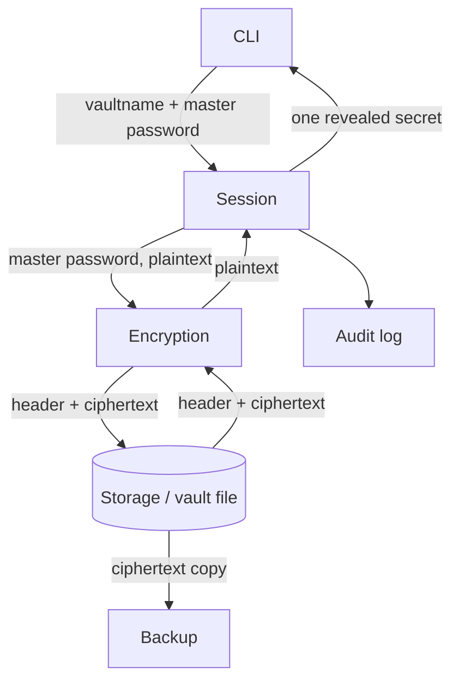

# ICS0022 Secure Programming: project report

**Project:** Secure Password Manager (CLI)
**Author:** Jevgeni Arefjev
**Date:** 2026-11-15
**Repository:** github.com/jevgeni-arefjev/secure-pass-manager

## 1. Introduction

### 1.1 Goal

The project is a local password manager. Each person keeps their secrets in their own encrypted vault on their own device and uses it through a command-line app, `vault`. A secret is everything needed to access one service: title, username, password, URL, notes, tags and any custom fields, each custom field marked hidden or not.

The course asks for secure storage of credentials, a protected master password, secure memory handling, input validation, a usable interface that never shows passwords in cleartext, per-user access control, and secure error handling and logging. The sections below describe how each of these is met and where the design deliberately differs from the requirements.

The same Rust core is reused by the ICS0027 web front end, which is covered in its own report (`ICS0027-report.md`).

### 1.2 Scope and threat model

The app runs on Linux and macOS, with several users possible on one device, each with their own vault. There is no cloud sync and no automatic backup; the user makes ciphertext-only backups by hand.

Assumptions about the attacker:

- They have the encrypted vault files (stolen disk, backup, cloud copy).
- They have the source code.
- They can use the same device as another OS user, and can read its memory after a vault was unlocked, used and locked again.
- The user's own habits are not perfect: they may forget to lock, use a weak password, or copy secrets carelessly.

Out of scope: a compromised host while the vault is unlocked (keyloggers, live memory snapshots of the running process).

The full threat table is in `secure-password-manager.md` §4.

### 1.3 Deliberate deviations from the requirements

All three were approved by the instructor and are recorded as ADRs.

| Requirement | What the app does instead | Why |
| --- | --- | --- |
| Master password stored as a hash (e.g. bcrypt) | Nothing is stored. Unlock derives a key with Argon2id and tries to unwrap the vault key; a failed tag check is a wrong password (ADR-0002) | A stored hash would be a second offline brute-force target and prove nothing the wrapped key doesn't already prove |
| Per-user ownership on every record operation | One vault file per user; a session opens only the vault it unlocked (ADR-0001) | With all secrets in one encrypted body, per-record checks would be meaningless; another user's vault is unreachable and wouldn't decrypt anyway |
| Parameterized statements against injection | No database: the vault is a flat `header ‖ body` file (ADR-0011) | There is no query language to inject into; the only parser of an untrusted vault file is a fixed-length header decoder |

## 2. Implementation

### 2.1 Language and structure

The app is written in Rust (edition 2024). Rust gives C-level control over memory (needed for locking and wiping key buffers) while ruling out whole classes of memory bugs such as buffer overflows, use-after-free and data races. Every crate is compiled with `#![forbid(unsafe_code)]`; page locking goes through a crate with a safe API.

The Cargo workspace has three crates:

| Crate | Role |
| --- | --- |
| `vault-core` | Shared library: encryption, storage, session, audit log, backup, password generator |
| `vault-cli` | The `vault` binary (this course) |
| `vault-web` | The HTTPS server (ICS0027) |

Modules in `vault-core`:

| Module | Responsibility |
| --- | --- |
| `crypto` | Key derivation, vault key wrap, body encryption, nonces and salts, header encoding, locked and zeroized secret memory |
| `storage` | Vault files: one vault home per vaultname, atomic, locked and revision-checked saves |
| `session` | Unlock and lock, auto-lock, the secret model and field validation, master password policy; the only module that handles decrypted secrets |
| `audit` | Audit events as JSON Lines in each vault home |
| `backup` | Verified, ciphertext-only copy of a vault file |
| `generator` | Random passwords from the OS CSPRNG |



### 2.2 Encryption methods

All primitives come from the audited RustCrypto crates (`argon2`, `chacha20poly1305`, `hkdf`); randomness comes from the OS CSPRNG (`getrandom`). No cryptography is implemented by hand.

**Key hierarchy.**

```
master password ──Argon2id──▶ KEK ──XChaCha20-Poly1305 wrap──▶ vault key (random, 32 bytes)
                                                                    │
                                                              HKDF-SHA-256
                                                                    ▼
                                         body key ──XChaCha20-Poly1305──▶ encrypted body
```

| Step | Algorithm | Parameters |
| --- | --- | --- |
| Master password → KEK | Argon2id | m = 256 MiB, t = 3, p = 1, 16-byte random salt |
| KEK wraps the vault key | XChaCha20-Poly1305 | 192-bit random nonce; associated data: magic, format version, salt |
| Vault key → body key | HKDF-SHA-256 | Versioned info string, so a future format can derive a different key |
| Body encryption | XChaCha20-Poly1305 | 192-bit random nonce; associated data: the whole encoded header |

- **Argon2id** is memory-hard and the current first choice of OWASP for password hashing. At 256 MiB per guess, offline brute force against a stolen vault is very expensive, especially on GPUs.
- **XChaCha20-Poly1305** is used for both the key wrap and the body, so only one AEAD has to be right. Its 192-bit nonce makes random nonces safe without a counter, and it is fast in software without hardware AES.
- **The master password is NFC-normalized** before key derivation (ADR-0007), so the same password typed on a different keyboard or OS still unlocks the vault.

**Vault file format.** A vault file is `header ‖ body` with no container around it:

| Field | Bytes | Purpose |
| --- | --- | --- |
| magic `SPMV` | 4 | Identifies a vault file |
| format version | 2 | Fixes the KDF and its params |
| salt | 16 | Argon2id salt |
| wrap nonce | 24 | Nonce of the key wrap |
| wrapped key | 48 | Vault key and its tag |
| revision | 8 | Counter of saves |
| body nonce | 24 | Nonce of the body |

- The header is a fixed 126 bytes with no length fields. Its decoder is the only parser that ever sees an untrusted vault file.
- The whole header is authenticated as associated data of the body, so changing any header field makes the vault fail to open.
- **No KDF parameters are stored** (ADR-0005). The format version alone fixes them, so a crafted header can't force a huge memory allocation or a weak KDF. Tests use a cheap twin format (OWASP minimum, 19 MiB) that exists only behind a Cargo feature; a release build refuses to compile with it.
- **The body** is a JSON array of all secrets, length-prefixed and padded to a multiple of 4 KiB, then encrypted as one block. An attacker with the file learns neither the number of secrets nor whether a particular secret (e.g. a GitHub account) exists.
- **Changing the master password rotates the vault key.** A new random vault key re-encrypts the body, and a fresh salt derives the KEK that wraps it, so a copy taken before the change never decrypts later versions, even with the old password.

**Unlock without a stored hash.** Unlock derives the KEK and tries to unwrap the vault key. A failed Poly1305 tag check means a wrong password. Every attempt, right or wrong, costs a full Argon2id run, and every failure waits until at least one second has passed and shows the same message, whether or not the vaultname exists.

### 2.3 Storage

- Each vault lives in its own **vault home**, `<vault directory>/<vaultname>/`, holding `secrets.vault`, its audit log and an empty lock file (ADR-0009). Vault homes are created with mode `0700`, files with `0600`; looser permissions draw a warning.
- **Atomic saves.** A save writes the new vault to a temp file, fsyncs it, renames it over `secrets.vault` and fsyncs the directory. A crash leaves either the old vault or the new one, never a mix. `init` builds the vault in a temp file and hard-links it into place, which fails if the vaultname is already taken.
- **No lost updates.** A save holds an exclusive lock on `secrets.lock` and only succeeds if the stored revision is the one it follows. Otherwise it fails with a conflict and the session locks.
- **Size limit.** A vault file over 64 MiB is refused before it is read, and a save that would pass it is refused before anything is written.

### 2.4 Memory management

Rust's ownership model frees memory deterministically, but freeing does not wipe. The app adds the following on top.

- **Zeroize on drop.** Every secret type (master password, KEK, vault key, body key, decrypted body, hidden field values) wraps its buffer in `zeroize`, so it is overwritten when dropped. Secret types implement neither `Clone` nor `Debug`/`Display` with their contents, so no implicit copy or accidental print can happen.
- **Page locking.** The master password, KEK, vault key, body key, decrypted body while it is parsed, and every hidden field value live in pages locked with `mlock`, so they are never written to swap. If the OS refuses (e.g. `RLIMIT_MEMLOCK` reached), the buffer falls back to zeroize-only and the session prints one warning. Non-hidden fields (title, username, URL, notes, tags) are zeroize-only, which is why anything sensitive belongs in a hidden field.
- **Argon2id working memory.** The 256 MiB the KDF works in would give the KEK (its last block) or a cheap password test (its first blocks), so `derive_kek` allocates it itself and zeroizes it when dropped, also on error. The `argon2` crate's own buffer is freed without being wiped. It is too large to lock under usual `RLIMIT_MEMLOCK` limits, so it could be swapped out during the roughly one-second derivation; encrypted swap closes that gap.
- **AEAD results are `#[must_use]`**, so a failed tag check can't be ignored.
- **Core dumps disabled.** At startup the process sets `RLIMIT_CORE` to 0 and, on Linux, `PR_SET_DUMPABLE` to 0, which also stops a piped crash handler (systemd-coredump, apport) from saving memory and blocks `ptrace` from other processes of the same user.
- **Keys exist only in the `vault>` process.** They are never written to disk and are wiped on `lock`, Ctrl-D, idle timeout, a termination signal (SIGTERM, SIGHUP, SIGINT, SIGQUIT) or a panic.
- **Auto-lock.** A watcher thread wipes the keys the moment the idle timeout passes (default 5 minutes, 1–60 per unlock), even while the shell is waiting for input, and clears the clipboard.
- **Own masked prompt** (ADR-0008). Hidden input is read with a small raw-mode reader that puts each key straight into a zeroizing buffer, instead of a library that keeps input in its own unwiped `String`s.
- **No strength estimator** such as zxcvbn, because it copies the password into heap strings that are freed without wiping.

Accepted limits: memory is not wiped if the process gets SIGKILL (core dumps stay off), and `mlock` does not keep pages out of a hibernation image.

### 2.5 Input validation

All rules live in the core (ADR-0013), so the CLI and the web front end apply the same ones. A refused save lists every invalid field at once and names the rule, never the value.

| Input | Rule |
| --- | --- |
| Vaultname | Allowlisted charset and length, because it becomes a directory name; the path is built only inside the vault directory; a symlinked vault home is refused |
| New master password | 12–1024 characters after NFC, no control characters, not a single repeated character, not on a built-in list of common passwords |
| Title | 1–64 characters; lookups ignore case, surrounding spaces and Unicode composition |
| Username / notes | 1–256 / 1–4096 characters (notes may contain newlines and tabs) |
| URL | 1–2048 characters; `http://` or `https://` with a host, or a bare host. `javascript:`, `data:`, `file:` and similar are refused |
| Tags, custom fields | At most 32 each, unique ignoring case and composition, with length limits |
| Hidden fields | 1–1024 characters, stored byte for byte; only control characters refused |

- Non-hidden fields refuse control characters, the whole Unicode format category (zero-width characters, bidi overrides, soft hyphen, tag characters) and line/paragraph separators, so nothing invisible can disguise a title or drive the terminal. They are stored NFC-normalized and trimmed.
- The CLI also escapes every stored text it prints (`\x1b`, `\u{202e}`), in case a vault was written by another build.
- Lengths count characters, not bytes.
- Hidden prompts refuse a paste containing a line break or other control character, or one that would pass 1024 characters, as a whole.

### 2.6 User interface

Commands at the OS shell: `vault init`, `vault unlock`, `vault gen`. Unlocking opens the **vault shell** (`vault>`) with `get`, `save`, `list`, `rm`, `gen`, `passwd`, `backup`, `log`, `lock` and `help`. A typical session:

```
$ vault unlock alice
Master password: *********************
vault 'alice' unlocked; it locks after 5 idle minute(s). Type `help` for commands.
vault> save github
Username (optional): alice
Password (empty to generate):
...
secret added
vault> get github --copy
password copied; the clipboard clears in 20 seconds
vault> lock
vault locked
```

- Passwords are **never shown in cleartext by default**. `get` masks every hidden field as a single `*`, whatever its length. `get --show` unmasks one secret, and only when stdout is a terminal.
- `get --copy` copies the password to the clipboard, marked as excluded from clipboard history, and clears it after 20 seconds, on lock, on exit and on a termination signal.
- `list` shows titles, usernames, URLs and tags, never hidden fields.
- Master passwords and hidden fields are entered only through hidden prompts, never as arguments or environment variables.
- An unknown command at `vault>` is reported without repeating it, in case a password was pasted there by mistake.
- Command history is kept in memory only.

### 2.7 Access control

Each user has their own vault file (ADR-0001). A session is bound to the one vault it unlocked and holds only that vault's keys, so no command can reach another user's secrets. Another user's file wouldn't decrypt without their master password anyway. Ownership is checked once, when the vault is opened, instead of on every record operation.

### 2.8 Error handling and logging

Every error belongs to one of four classes (ADR-0014), and the class decides what the person sees and what is logged.

| Class | Shown to the person | Audit event | Diagnostic |
| --- | --- | --- | --- |
| Input mistake | A specific message naming the field and rule, never the value | No | No |
| Security refusal (e.g. unlock failed) | One generic message, after the same minimum delay | Unlock failed, if the vault exists | No |
| Session ended | A fixed "vault is locked" message | The lock that ended it | No |
| Internal failure | A generic message plus the cause kind in words, e.g. `vault storage failed (disk full)` | No | Cause kind only |

- **Audit log** (ADR-0010). Each vault home has `audit.log`, JSON Lines with a UTC timestamp, the event kind and at most the title of the secret concerned, never a field value. Recorded: vault created, unlocked, unlock failed, locked, auto-locked, locked on conflict, terminated by signal, secret saved, removed and revealed, master password changed or change failed, backup exported. The owner reads it with `log`. It is written only after the action succeeds, rotates at 1 MiB, and is fail-open: if it can't be written, the operation still happens and the session warns once.
- **Diagnostics** go to stderr and never hold a field value, master password, path or panic message. Cause kinds are `std::io::ErrorKind` names, never OS error text, which can carry a path.
- **Panics** are printed only as `vault: internal error at <file>:<line>`; the session is wiped and the clipboard cleared first.

### 2.9 Backup

`backup <path>` copies `secrets.vault` exactly as stored, never decrypted. The destination must be new and outside the vault directory. The copy is written to a `0600` temp file, read back, checked to open with the session's vault key, and only then renamed into place without overwriting. Restoring means putting the file into a vault home as `secrets.vault`; any vaultname works.

## 3. Security analysis

### 3.1 Threats and mitigations

| Threat | Mitigation | Residual risk |
| --- | --- | --- |
| Offline brute force of a stolen vault | Argon2id at 256 MiB per guess; release builds accept no cheaper params; no password hash to attack instead | A weak master password is still guessable; the policy refuses the weakest |
| Header tampering | Header is associated data of the body; no KDF params read from it | None known |
| Vault file reveals what it contains | Whole body encrypted under one key, padded to 4 KiB | File size reveals the vault's size in 4 KiB steps |
| Crafted vault file attacking the parser | No container; fixed 126-byte header decoder; body authenticated before it is parsed; property tests feed random input to the decoder and the whole unlock path | None known |
| Path traversal through the vaultname | Allowlist; path built only inside the vault directory; symlinked vault homes refused | None known |
| Crash or concurrent session corrupting the vault | Temp file + fsync + rename under a lock; revision check | Rollback to an older copy of the file is not detected (needs trusted state, out of scope) |
| Memory dump or swap | `mlock` on keys and hidden values; zeroize everywhere; core dumps off, non-dumpable | Non-hidden fields may reach swap; hibernation images; SIGKILL |
| Unattended session | Idle auto-lock wipes keys immediately; signals wipe before exit | Lock on screen lock or suspend is not implemented |
| Secrets in shell history, process list or env | Never accepted as arguments or env vars; hidden prompts only; prompts refuse a non-terminal stdin | Star echo shows the length of what is typed (ADR-0008) |
| Secrets in scrollback, logs or pipes | Hidden fields masked as one `*`; `--show` refused when stdout is not a terminal; audit log and diagnostics never hold field values | `--show` output stays in the terminal scrollback |
| Clipboard | Excluded from history, cleared after 20 s, on lock, exit and signal | A clipboard manager that ignores the hint |
| Terminal escape or bidi spoofing in stored text | Refused on save; escaped on output | None known |
| Timing or message differences on unlock | Same message and at least 1 s for every failure, whether or not the vaultname exists | None known |
| Old master password after a change | Vault key rotated on every change | An old file copy still opens with the old password |

### 3.2 Testing

Tests use Rust's built-in test framework and are run by CI (GitHub Actions) on macOS, Ubuntu and Fedora on every push, together with `cargo fmt`, `cargo clippy -D warnings` (which also requires a docstring on every item) and a release build.

`cargo test --no-fail-fast` on 2026-11-15 (Fedora 44), for the crates of this course:

| Crate | Unit + integration tests | Doc tests | Result |
| --- | --- | --- | --- |
| `vault-core` | 183 (+1 ignored: production KDF) | 165 | all passed |
| `vault-cli` | 107 | 38 | all passed |

Selected security test cases:

| Area | Test file | What it shows |
| --- | --- | --- |
| Encryption | `vault-core/tests/crypto.rs` | Round trip; wrong password fails; every tampered header field and body byte fails; a password change rotates the vault key, so an old copy doesn't decrypt the new body; random input to the header decoder never panics (property tests) |
| Memory | `vault-core/tests/memory.rs` (Linux) | Master password, vault key, decrypted body and hidden values sit in locked pages; zeroize-only fallback warns once; core dumps off (`RLIMIT_CORE` = 0, non-dumpable) |
| Input validation | `vault-core/tests/text_rules.rs`, `field_checks.rs` | Every unsafe character in the shared fixture is refused; limits counted in characters; NFC and trimming; URL forms (`javascript:` refused); stored secrets breaking newer rules still open |
| Storage | `vault-core/tests/storage.rs` | Size limit on load and save; lock held too long; revision conflict |
| Session | `vault-core/tests/session.rs` | Uniform unlock failure and minimum delay; auto-lock; access to one vault only; internal failures keep their cause kind |
| Audit | `vault-core/tests/audit.rs` | Events contain at most a title; rotation; fail-open warning |
| Backup | `vault-core/tests/backup.rs` | Never overwrites; refuses destinations inside the vault directory or through symlinks; verifies before rename |
| CLI end to end | `vault-cli/tests/shell.rs` | Scripted fake terminal; three tries; auto-lock watcher; panics wipe the session and clear the clipboard |
| No leaks | `vault-cli/tests/no_secret_leaks.rs` | A scripted session with wrong, weak and changed master passwords, saved and refused hidden fields, `get --show` into a pipe, backup and log: no master password or hidden value appears in stdout, stderr, diagnostics at any level or the audit log |
| Output | `vault-cli/tests/render.rs` | Hidden fields masked; every stored text escaped against the shared fixture |

The production KDF (256 MiB Argon2id) has its own slow test, run with `cargo test -- --ignored`.

## 4. Conclusion

The app meets the ICS0022 requirements:

| Requirement | How it is met |
| --- | --- |
| Secure storage | Argon2id + XChaCha20-Poly1305 + HKDF-SHA-256; one padded, authenticated body per vault; add, get, update and delete through the vault shell |
| Master password | Never stored, not even as a hash; unlock by unwrapping the vault key (approved deviation, ADR-0002) |
| Secure memory | `mlock` + `zeroize` on all key material and hidden values; no unsafe code; core dumps off; keys wiped on lock, timeout, signal and panic |
| Input validation | One set of field rules in the core; vaultname allowlist; strict fixed-length header parser; no query language (ADR-0011) |
| Interface | Simple vault shell; hidden fields masked by default; hidden prompts only |
| Access control | One vault file per user; a session opens only its own vault (approved deviation, ADR-0001) |
| Errors and logging | Four error classes with generic messages; JSON Lines audit log of key events with no field values; diagnostics without paths or secrets |

Choices worth highlighting: not storing a password hash removes a second attack target; fixing KDF params by format version removes a whole class of header attacks; replacing SQLite with a flat file left a 126-byte decoder as the only parser of untrusted input.

Known limitations and possible next steps:

- Rollback to an older copy of a vault file is not detected.
- Non-hidden fields are not page-locked and may reach swap.
- No lock on screen lock or suspend.
- No multi-factor unlock.
- Freed disk blocks of an old vault file are not wiped.

Rust was chosen with little prior experience in it, on the assumption that not hand-managing memory leads to safer code. In practice the type system turned several rules (no copies of secrets, no printing of secret types, no ignored tag failures) into compiler checks.
