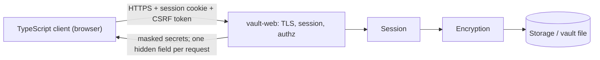

# ICS0027 Web Application Security: project report

**Project:** Web-Based Secure Password Manager
**Author:** Jevgeni Arefjev
**Date:** 2026-11-15
**Repository:** github.com/jevgeni-arefjev/secure-pass-manager

## 1. Introduction

### 1.1 Goal

The project is a web-based password manager built on the ICS0022 Secure Password Manager. It reuses the same Rust core (`vault-core`: encryption, storage, session, audit log, backup) and adds:

- `vault-web`, an HTTPS server in Rust that handles TLS, sessions, CSRF, security headers and per-request authorization;
- `web/`, a TypeScript browser client with no runtime dependencies, embedded into the server binary.

Each person has their own vault, opened with a vaultname and master password. The browser lets them create, unlock and lock a vault, list and search secrets, view one with its hidden fields masked, reveal or copy one hidden field at a time, add, edit and delete secrets, change the master password, download an encrypted backup and read the vault's audit log.

The course asks for a secure login, secure sessions, protection against SQL injection, XSS and CSRF, per-user access control, and generic errors with structured logging. The sections below describe how each is met.

### 1.2 Scope and threat model

The web front end is a **local demo**: the server runs on the user's own machine and binds to a loopback address only. This follows from a design where the server holds unwrapped keys for the life of a session, which needs a long-lived process.

- **The server is trusted.** It runs on the user's machine.
- **The browser is semi-trusted.** It belongs to the user but runs extensions and other tabs, so every request is checked against session state, and the browser receives as little plaintext as possible.
- **Other websites are hostile.** They can send requests to `localhost` (CSRF) or point their own domain at it (DNS rebinding).

Out of scope: a compromised browser session while the vault is unlocked, lockout per vaultname or IP (it would let anyone lock another user out), and deployment beyond localhost.

Master password, vault-at-rest and vault-in-memory threats are covered in the ICS0022 report and in `secure-password-manager.md` §4. Web-specific threats are in `web-app-security.md` §4.

### 1.3 Deliberate deviations from the requirements

All were approved by the instructor and are recorded as ADRs.

| Requirement | What the app does instead | Why |
| --- | --- | --- |
| Prepared statements and parameterized queries against SQL injection | No database: each vault is a flat `header ‖ body` file (ADR-0011) | There is no query language, so injection is ruled out by design instead of guarded against |
| Per-user ownership on every record operation | One vault file per user; the vault is resolved from the session only (ADR-0001) | Another user's vault can't be named in a request at all, and wouldn't decrypt anyway |
| Master password stored as a hash | Nothing stored; unlock succeeds only if the vault key unwraps (ADR-0002) | No second offline brute-force target |
| CSRF tokens on all forms | Per-session CSRF token in a request header on every state-changing API request | The client is a single-page app that talks to a JSON API; there are no HTML form posts |

The fourth row is an interpretation rather than a deviation: the token protects every state-changing request, which is what the requirement is for.

## 2. Implementation

### 2.1 Architecture



| Part | Technology | Responsibility |
| --- | --- | --- |
| `vault-web` | Rust, axum, rustls (ring) | TLS, routing, sessions, CSRF, Host and Origin checks, security headers, KDF limiter, request logs |
| `vault-core` | Rust (from ICS0022) | Encryption, storage, session, field validation, audit log, backup |
| `web/` | Vanilla TypeScript, bundled by esbuild | UI only: pages, forms, reveal timer, clipboard |

**Decryption happens on the server** (ADR-0012). The browser sends the vaultname and master password over TLS; the server derives the key, unwraps the vault key and holds the decrypted vault in locked, zeroized memory. The browser never receives the vault key or the whole vault: lists and detail pages contain only non-hidden fields, and each reveal request returns one hidden value. Password managers such as Bitwarden decrypt in the client instead, which protects against an untrusted server. Here the server is the user's own machine, and server-side decryption keeps all crypto and memory handling in Rust, keeps plaintext out of the browser heap, and lets the server enforce auto-lock and audit events.

**API.**

| Route | Purpose |
| --- | --- |
| `POST /api/vaults` | Create a vault |
| `POST /api/unlock`, `POST /api/lock`, `GET /api/session` | Unlock, lock, session state |
| `GET /api/secrets`, `GET /api/secrets/{title}` | List; detail with hidden fields named, never sent |
| `POST /api/secrets/{title}/reveal` | One hidden field of one secret, audited |
| `POST /api/secrets`, `PUT /api/secrets/{title}`, `DELETE /api/secrets/{title}` | Add, replace, delete |
| `POST /api/master-password` | Change the master password |
| `POST /api/backup` | Download the encrypted vault file |
| `GET /api/audit-log?limit=N` | The vault's audit events, newest first |

### 2.2 Encryption methods

The web front end uses the ICS0022 core unchanged:

| Step | Algorithm | Parameters |
| --- | --- | --- |
| Master password → KEK | Argon2id | m = 256 MiB, t = 3, p = 1, 16-byte random salt; fixed by the format version (ADR-0005) |
| KEK wraps the random 32-byte vault key | XChaCha20-Poly1305 | 192-bit random nonce; header fields as associated data |
| Vault key → body key | HKDF-SHA-256 | Versioned info string |
| Body (all secrets, padded to 4 KiB) | XChaCha20-Poly1305 | 192-bit random nonce; whole header as associated data |

All primitives come from the RustCrypto crates. Changing the master password rotates the vault key. Details are in the ICS0022 report, §2.2.

**In transit**, everything goes over TLS (rustls with the `ring` provider). Without certificate flags the server generates a self-signed certificate for `localhost` and `127.0.0.1` on first start and caches it with mode `0600`; `--tls-cert`/`--tls-key` take e.g. `mkcert` certificates that the browser trusts. There is no plain-HTTP listener.

### 2.3 Authentication

- **Unlock** (`POST /api/unlock`) takes a vaultname and master password. The master password goes straight from the JSON body into a locked, zeroizing `MasterPassword`, never into an ordinary `String`.
- **No password hash is stored.** The server derives the KEK with Argon2id and tries to unwrap the vault key; a failed tag check is a wrong password.
- **Generic failure.** Every failed unlock gets the same `401` response after at least one second, whether or not the vaultname exists, so neither the message nor the timing tells an attacker which vaultnames exist.
- **Creating a vault reveals a taken vaultname** (`409`), by necessity: the vaultname is the account's identifier and there is no confirmation email to answer through, so a failed create always differs from a successful one. This is an accepted trade-off (ADR-0014). Each probe is slow: the 256 MiB Argon2id KDF runs before the name is checked, and the KDF limiter (below) caps how many run at once.
- **New master passwords** (create, change) must be 12–1024 characters with no control characters, not a single repeated character, and not on a list of common passwords. The client checks this as the user types; the server checks it again before running the KDF.
- **Changing the master password** requires the current one. Three wrong current master passwords in a row lock the session. A successful change locks the vault's other web sessions and reissues the current one under a new session ID.
- **KDF limiter.** Every unlock, create and change costs a 256 MiB Argon2id run. At most two run at once, two more wait, and further requests get `503`, so a flood of unlock requests can't exhaust memory. The KDF runs on a blocking thread pool, off the async workers.
- **Multi-factor authentication** is optional in the requirements and not implemented; a TOTP step is planned.

### 2.4 Session management

| Property | Implementation |
| --- | --- |
| Session ID | 256 random bits from the OS CSPRNG, new on every unlock; the server stores only its SHA-256 hash |
| Cookie | `__Host-session; HttpOnly; Secure; SameSite=Strict; Path=/`; deleted on lock |
| CSRF token | 256 random bits per session; returned in the unlock response, kept in browser memory only (never in storage or a cookie) |
| Idle timeout | Default 5 minutes, 1–60 chosen at unlock; enforced on the server |
| Absolute lifetime | 8 hours after unlock, whatever the activity |
| Ending a session | Keys zeroed and the vault locked; next request gets `401`; `Clear-Site-Data` on lock |

- A background sweeper locks idle and expired sessions on the server, so an abandoned tab doesn't keep the vault open.
- SIGINT and SIGTERM lock every session before the server exits.
- A panicking request gets a generic `500` and its session is locked.
- A save conflict (another session saved first) locks the session (`401`).
- The client checks its session every 30 seconds and when the tab becomes visible again, and returns to the unlock page once the session has ended.

### 2.5 CSRF and cross-origin protection

Three independent layers:

1. **`SameSite=Strict` cookie.** The browser doesn't send the session cookie on requests started by another site.
2. **CSRF token.** Every state-changing request (`POST`, `PUT`, `DELETE`) must carry the session's token in a request header. The server compares it in constant time. Another origin can't read the token, because it lives only in the client's memory and is never in a cookie.
3. **Origin check.** A state-changing request whose `Origin` header is not the server's own origin is refused.

In addition, **every request is checked against its `Host` header**: only `localhost:<port>` and `127.0.0.1:<port>` are served. This stops DNS rebinding, where a malicious domain is made to resolve to `127.0.0.1` so the browser treats requests to the local server as same-origin. `--bind` refuses any non-loopback address.

### 2.6 Access control

Every handler gets its vault from the session extractor, which resolves the session from the cookie, checks the CSRF token where needed, and hands out access to that session's vault only. No handler reads a vaultname or any other identity from the request body or URL. A secret is named by its title in the URL, but only within the session's own vault; an unknown title is a `404`. Another user's secrets are unreachable by construction, and their vault file wouldn't decrypt without their master password.

### 2.7 SQL injection

There is no SQL anywhere in the application. Each vault is a flat file (`header ‖ encrypted body`, ADR-0011), and the server reads and writes it whole. There is no query language and no string is ever interpreted as a command, so there is nothing to inject into.

The application did use SQLite at first (ADR-0006), with parameterized statements, kept mainly because of this course's requirement. It was replaced with the flat file after instructor approval: SQLite held two blobs in one row and ran no real query, and dropping it removed SQLite's C parser from the path of untrusted vault files, leaving a strict fixed-length 126-byte header decoder as the only parser.

The remaining injection surface is the vaultname, which becomes a directory name. It is allowlisted (restricted charset and length), the path is built only inside the vault directory, and a vault home that is a symlink is refused, so path traversal (`../`) is impossible.

### 2.8 XSS

| Layer | Measure |
| --- | --- |
| Rendering | The client builds the DOM only with `createElement` and `textContent`; `innerHTML` and similar sinks are never used |
| Trusted Types | The CSP requires Trusted Types for scripts, so the browser itself blocks any string reaching an HTML sink |
| Content Security Policy | Same-origin code only, no inline script or style, no framing (below) |
| Links | A secret's URL becomes a link only if it is `http:` or `https:`; `javascript:` and `data:` are never links |
| Server-side validation | The core refuses `javascript:`, `data:`, `file:` and other schemes in the URL field, control characters and invisible Unicode (bidi overrides, zero-width characters) in all non-hidden fields |
| Display escaping | The client escapes exactly the characters the server refuses, in case a vault was saved by an older build |
| Supply chain | The client bundle is embedded in the server binary; nothing is fetched at runtime and the client has no runtime dependencies |

The Content Security Policy sent on every response:

```
default-src 'none'; script-src 'self'; style-src 'self'; img-src 'self';
connect-src 'self'; form-action 'self'; base-uri 'none';
frame-ancestors 'none'; require-trusted-types-for 'script'
```

Other security headers on every response:

| Header | Value | Purpose |
| --- | --- | --- |
| `Strict-Transport-Security` | `max-age=300` | HTTPS only; short so other local dev servers aren't affected |
| `X-Content-Type-Options` | `nosniff` | No MIME sniffing |
| `Referrer-Policy` | `no-referrer` | Titles in URLs never leak |
| `Cross-Origin-Opener-Policy` | `same-origin` | Isolates the window from cross-origin openers |
| `Cross-Origin-Resource-Policy` | `same-origin` | Other sites can't embed responses |
| `Permissions-Policy` | camera, microphone, geolocation, ... all `()` | Unused browser features disabled |
| `Cache-Control` | `no-store` | Vault data never in the browser's disk cache |

### 2.9 Input validation

- **JSON bodies** are parsed strictly: at most 64 KiB, objects only, unknown fields refused.
- **Secret fields** go through the same core rules as the CLI (ADR-0013): length limits counted in characters, URL forms, no control or invisible characters in non-hidden fields, NFC normalization, uniqueness of tags and custom field names. A refused save returns every invalid field at once (`"fields"`), and the form marks each one.
- **Hidden values** go straight from the JSON body into a locked `HiddenValue`. When editing, the client sends `{"unchanged": true}` for hidden fields the user didn't touch, so the server keeps them and the browser never needs to hold them.
- An empty password field makes the server generate one.

### 2.10 Error handling and logging

Errors follow the four classes of ADR-0014:

| Class | Response |
| --- | --- |
| Input mistake | `400`/`404`/`409`/`413` with a message naming the field and rule, never the value |
| Security refusal (unlock failed, CSRF, Origin, Host) | One generic message per refusal |
| Session ended | `401` "vault is locked" |
| Internal failure (storage, RNG, panic) | `500` `{"error":"internal error"}`; no stack trace or internals |

Two kinds of structured logs, both JSON:

- **Audit log** (owner-facing, per vault, JSON Lines): vault created, unlocked, unlock failed, locked, auto-locked, locked on conflict, secret saved, removed and revealed, master password changed or change failed, backup exported. Each event holds a timestamp, its kind and at most a title, never a field value. The owner reads it on the audit log page.
- **Diagnostics** (operator-facing, stderr, JSON lines at a fixed `INFO` level). Each request line holds the method, route template (not the URL, so no title), status, latency and a short hash of the session ID. An internal failure adds one `internal_error` line with what failed and its `io::ErrorKind`. A panic is logged as its location only. No line ever holds a master password, field value, path, cookie, header or session ID. `RUST_LOG` is ignored, because debug output from dependencies has not been checked for secrets.

```text
{"timestamp":"2026-11-08T10:00:00.000000Z","level":"INFO","event":"request","method":"GET","route":"/api/secrets/{title}","status":200,"latency_ms":1.2,"session":"3f9a1c0e"}
```

### 2.11 Memory and process hardening

The server inherits the core's memory handling: key material, the decrypted body and hidden values in `mlock`ed, zeroized buffers, and no `unsafe` code in any crate. The server refuses to start if it can't disable core dumps (`RLIMIT_CORE` = 0; on Linux also `PR_SET_DUMPABLE` = 0). In the browser, at most one revealed hidden value is held at a time; it is masked again after 30 seconds, and a copied value is cleared from the clipboard after 20 seconds (best effort: the browser allows it only while the page has focus).

## 3. Security analysis

### 3.1 OWASP Top 10 (2025)

| Category | Coverage |
| --- | --- |
| A01 Broken Access Control | Vault resolved from the session only; session cookie and CSRF token on every state-changing request; Origin and Host checks; lock ends the session |
| A02 Security Misconfiguration | Strict CSP with Trusted Types and a full set of security headers on every response, including errors; loopback-only binding; no debug logging |
| A03 Software Supply Chain Failures | Client embedded in the binary, no runtime dependencies or CDN; pinned versions in `Cargo.lock` and `package-lock.json` |
| A04 Cryptographic Failures | Argon2id, XChaCha20-Poly1305 and HKDF-SHA-256 from RustCrypto; TLS only; no stored password hash |
| A05 Injection | No SQL; vaultname allowlist; DOM built with `textContent`; URL scheme allowlist; CSP |
| A06 Insecure Design | Threat model and ADRs for every security decision; plaintext kept out of the browser |
| A07 Authentication Failures | Generic unlock error with constant minimum delay; new session ID on every unlock and password change; server-side idle timeout and absolute lifetime; KDF cost per guess |
| A08 Software or Data Integrity Failures | Authenticated header; atomic saves under a lock with a revision check |
| A09 Security Logging and Alerting Failures | Per-vault audit log of key events; JSON request logs without secrets |
| A10 Mishandling of Exceptional Conditions | Generic `500` without internals; a panicking request locks its session; a save conflict locks the session |

### 3.2 Threats and mitigations

| Threat | Mitigation | Residual risk |
| --- | --- | --- |
| Secrets read in transit | TLS only; HSTS | Self-signed certificate warning on first use unless `mkcert` is used |
| Session cookie stolen by script | `HttpOnly`; strict CSP | — |
| Session fixation | New session ID on every unlock and master password change | — |
| Session left open | Server-side idle timeout and 8 h lifetime; sweeper; `Clear-Site-Data` on lock | — |
| CSRF | `SameSite=Strict`; CSRF header token; Origin check | — |
| DNS rebinding | Host header check; loopback-only bind | — |
| Stored XSS through a secret field | `textContent` only; Trusted Types; CSP; server refuses unsafe URLs and characters | — |
| SQL injection | No SQL | — |
| Path traversal through the vaultname | Allowlist; path confined to the vault directory; symlinks refused | — |
| Request for another user's secret | Vault from session only; `404` for unknown titles | — |
| Online guessing of a master password | Argon2id cost and ≥ 1 s per failure; at most two KDF runs at once; failed unlocks audited | No lockout (by design, so others can't be locked out) |
| Memory exhaustion through unlock requests | KDF limiter: 2 running, 2 queued, then `503` | An attacker can keep the server busy |
| Plaintext in the browser | Only non-hidden fields; one hidden value per reveal, re-masked after 30 s; `no-store` | A malicious browser extension sees what the page shows |
| Compromise of the server process | Out of scope: it is the user's own machine | Every unlocked vault would be exposed (ADR-0012) |

### 3.3 Testing

Rust tests run the whole HTTP app in-process (tower `oneshot`) on a temporary vault directory with a manual clock, so timeouts, the sweeper and the KDF limiter are tested without waiting. Client helpers are tested with `node:test`. CI (GitHub Actions) runs everything on macOS, Ubuntu and Fedora on every push, along with formatting, clippy, the client lint and type check, and a release build.

Results on 2026-11-25 (Fedora 44):

| Suite | Tests | Result |
| --- | --- | --- |
| `vault-web` integration tests | 124 | all passed |
| `vault-web` doc tests | 23 | all passed |
| `web/` client tests (`npm test`) | 75 | all passed |
| `vault-core` (shared core, see ICS0022 report) | 183 + 165 doc tests | all passed |

Selected security test cases:

| Area | Test file | What it shows |
| --- | --- | --- |
| Headers, Host | `vault-web/tests/app.rs` | CSP and every security header on every response, including errors; foreign `Host` refused; request logs are JSON with fixed fields, level fixed even with `RUST_LOG=trace` |
| Authentication | `vault-web/tests/unlock.rs` | Cookie attributes; CSRF token issued; Origin checked; same response for wrong password and unknown vaultname; master password rules before the KDF; `503` when the limiter is full; strict JSON parsing; nothing secret in logs |
| Access control | `vault-web/tests/secrets.rs` | List and detail contain no hidden values; titles with unusual characters; `404` for unknown titles; a session sees only its own vault |
| Reveal | `vault-web/tests/reveal.rs` | One hidden value per request; CSRF required; plain fields refused; audit event written; value never in logs |
| Edits | `vault-web/tests/edit.rs` | Generated password; `409` on a taken title; unchanged hidden values kept; every field problem listed; CSRF; full vault `413`; save conflict locks |
| Sessions | `vault-web/tests/expiry.rs` | Idle timeout and 8 h lifetime; activity keeps a session open; lock all on shutdown; panicking request returns `500` and wipes the session |
| Master password | `vault-web/tests/master_password.rs` | Third wrong current password locks; other sessions locked; session reissued; nothing in logs |
| Backup, audit log | `vault-web/tests/backup.rs`, `audit_log.rs` | Download is the stored file byte for byte and audited; audit log holds no field values and shows only the own vault |
| TLS | `vault-web/tests/tls.rs` | Certificate loading; self-signed generation; `0600` cache |
| Client | `web/test/*.test.ts` | URL allowlist (`javascript:` never a link); text escaping against the shared unsafe-characters fixture; CSRF header on requests; `401` treated as locked; reveal re-mask and clipboard timers |

## 4. Conclusion

The web front end meets the ICS0027 requirements:

| Requirement | How it is met |
| --- | --- |
| Master password and authentication | Argon2id-based unlock with no stored hash; generic failure with constant delay; KDF limiter; MFA planned, not implemented |
| SQL injection | No SQL at all (approved, ADR-0011); vaultname allowlist against path traversal |
| XSS | `textContent`-only DOM; strict CSP with Trusted Types; URL allowlist on client and server; server-side input validation |
| Session security and CSRF | `__Host-` `HttpOnly` `Secure` `SameSite=Strict` cookie; server-side idle and absolute expiry; CSRF header token, Origin and Host checks |
| Access control | Vault resolved from the session only (approved, ADR-0001) |
| Errors and logging | Generic errors without internals; JSON audit log and request logs that never contain secrets |

The main design choice was to decrypt on the server. It keeps all key handling in Rust with locked, zeroized memory and keeps plaintext out of the browser, at the cost of trusting the server. That fits a local demo where the server is the user's own machine, but it would not fit a public, hosted service.

Known limitations and possible next steps:

- No multi-factor authentication (TOTP planned).
- Local demo only; public hosting would need client-side key derivation or decryption (ADR-0012 lists the options).
- No restore from backup in the browser; restoring is done by hand on the server.
- A self-signed certificate warns once unless `mkcert` is used.
