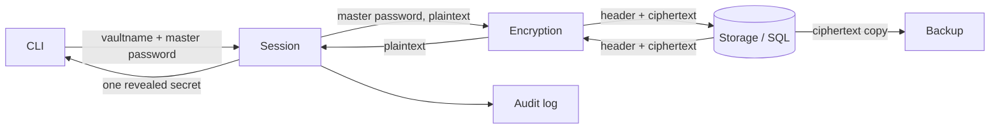
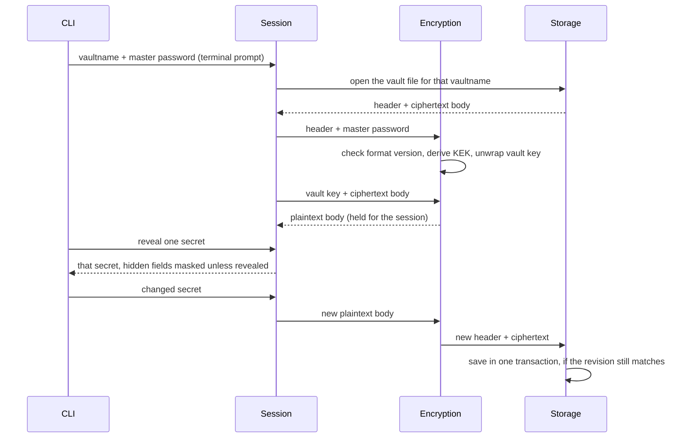

# Secure Password Manager — Core & CLI

GUI document: `web-app-security.md`

## 1. Scope

This app is:
- Desktop native
- Multi-user on single device: each user has their own vault file, identified by its vaultname (no teams or secret sharing)
- Fully local (no automatic backuping plan yet, only ciphertext export)
- Unlocked with a vaultname and master password (later maybe with MFA, Google SSO or similar)

## 2. Architecture

The app consists of 6 modules with responsibilities split between them. The goal of this app is to securely store secrets and protect against memory leaks, injection attacks and other cryptographic attacks.

| Module | Responsibility |
| --- | --- |
| CLI | Command parsing, terminal output, one-secret reveal, clipboard |
| Session | Unlock/lock state and session lifetime; holds the decrypted secrets, reveals them one at a time; owns the secret model and its serialization; **handles plaintext in memory** |
| Encryption | Encryption/decryption, key derivation, key wrap, nonces, salts, padding, header encoding; passes decrypted plaintext only to Session |
| Storage | Vault files (SQLite), schemas |
| Audit log	| Structured events - unlocks, failed unlock attempts, locks, vault changes |
| Backup | Ciphertext-only export of the user's vault |




### Data Flow



## 3. Design decisions

**Vault format.** Each user's vault is a separate SQLite file (ADR-0006), created by `vault init` as `secrets.vault` in its vault home, a directory named after its vaultname (ADR-0009). The directory name is the plain vaultname (not a hash), so a vault can still be found if its name is half-remembered; the contents stay encrypted. It holds a plaintext header + encrypted body (all secrets), header authenticated as associated data. This way it doesn't leak the number of secrets or existence of a specific secret (e.g. existence of a github account). A secret is everything needed to access one service: its credentials and metadata (title, username, password, URL, tags, ...).

It is also impossible to read other users' secrets: a session only ever opens the one vault it unlocked, and another user's file will not decrypt even if somehow obtained.

Header contains format version, salt, wrap nonce, wrapped vault key, revision counter, body nonce. The format version also fixes the KDF and its params, so no cost parameter is stored (ADR-0005). The vaultname is not in the header: it is only the name of the vault home, so renaming the vault home renames the vault and a backup can be restored under any name (ADR-0004, ADR-0009).

Body is a JSON of all secrets *(may be changed later)*, padded to 4 KiB, rewritten whole on every save. Per-secret encryption leaks the number of secrets and their sizes and multiplies nonce management, wchih gains nothing in performance, since the app is so small.

**Unlock.** The master password is never stored, not even as a hash. Unlock derives the KEK and tries to unwrap the vault key; a failed tag check means a wrong password. A separate password hash would be a second offline brute-force target while adding nothing the wrapped key doesn't already prove.

**Cryptographic scheme:**

Each vault has one random vault key, and one body key derived from it. Master password (or MFA/SSO) decrypts vault key. Vault key derives body key, which deciphers JSON block.

1) Argon2id (m=256 MiB, t=3, p=1) derives a KEK from the master password it was chosen to prevent brute force attacks against encrypted vault. The params are fixed by the format version in the header, not stored as separate values (ADR-0005). Raising them later means a new format version, and vaults in older versions keep working. Tests use a test twin of each format (top bit of the version set, OWASP minimum 19 MiB, t=2, p=1) that exists only in test builds;
2) KEK wraps a random 32-byte vault key; the vault key derives a body key via HKDF-SHA-256. XChaCha20-Poly1305 is used for both the wrap and the body (one AEAD, 192-bit random nonces). The format is KDF-agnostic. Details of this scheme may likely be changed in the future.
3) Changing the master password always rotates the vault key: a new random vault key (and with it a new body key, derived from it) re-encrypts the body, and a fresh salt derives a new KEK that wraps it. A copy of the vault taken before the change therefore never decrypts later versions, even with the old master password.

**Programming language - Rust.** It was chosen because it lets you control memory directly the way C does, but stops whole categories of memory bugs the way Java or Go do. I personally, don't have a lot of experience with Rust, and my assumption is that, long-term, avoiding hand-managing memory will result in safer code, as there will be less opportunities for human error bugs.


## 4. Threat model

### Security Assumptions

- **An attacker has access to the encrypted vault files.**
- **An attacker has access to the application source code.**
- **An attacker can use the same device (as a different user) and read memory on target device after the vault has been unlocked and used and is locked again.**
- **App user might not have the best password hygiene or be a proficient PC user.**
They might forget to lock the vault, accidentally copy or display all their secrets, or use an easy password.

### Out of scope - not covered threats:

- **The host device is trusted while unlocked.**
- **The attacker might have a keylogger on target device or do memory snapshots while app is in use.**

### Threat analysis

| Surface | Threat | Mitigation |
| --- | --- | --- |
| Master password | Offline brute force against a stolen vault | Every vault uses Argon2id with 256 MiB of memory per guess, and release builds accept no other params (the cheaper test formats are compiled only into test builds), so brute forcing is not an option; no password hash is stored that could be attacked instead |
| Master password | Old master password leaked together with an old copy of the vault | Accepted: it decrypts only that old snapshot; every master password change rotates the vault key, so later versions stay protected |
| Master password | Weak password chosen by the user | Length rule (at least 12 characters), a single repeated character and a built-in list of common passwords are refused. No strength meter: estimators such as zxcvbn copy the password into heap strings that are freed without zeroizing, breaking the no-implicit-copies rule below |
| Vault at rest | File stolen from disk, backup or cloud sync | Whole body encrypted under a random vault key; only the header is readable |
| Vault at rest | Header tampering | Header is authenticated as associated data so altered fields fail the tag check; no KDF params are read from the header (the format version fixes them), so a crafted header can't force a huge allocation |
| Vault at rest | Two vaults with the same master password swapped on disk | Accepted: needs write access to the vault directory and reveals nothing; vaults with different passwords fail to unlock (ADR-0004) |
| Vault at rest | Rollback: an older copy of the vault file put in place of the current one, bringing back a rotated password or dropping newer secrets | Accepted: detection needs trusted state the attacker can't roll back at the same time (hardware counter, remote server or a per-device state file), which is out of scope. An attacker with write access to the vault directory can usually replace the binary anyway. The authenticated revision counter only orders backups and writes; it is not rollback protection |
| Vault at rest | Corruption or crash mid-write losing the vault | Each save is one SQLite transaction (`journal_mode=DELETE`, `synchronous=FULL`); `init` builds the new vault in a temp file and hard-links it into place (ADR-0006) |
| Vault at rest | Two sessions on the same vault overwriting each other's changes | A save only succeeds if the stored revision is the one it follows; otherwise it fails with a conflict and the session must unlock again |
| Vault at rest | Crafted vault file attacking the SQLite parser (e.g. a restored backup from an untrusted place) | Every connection enables `SQLITE_DBCONFIG_DEFENSIVE` and `trusted_schema=OFF`, and checks `application_id` and `user_version` before reading any table (ADR-0006) |
| Vault at rest | Old ciphertext left in the file after a save, e.g. the header wrapped under a rotated master password | `secure_delete=ON` zeroes freed pages. Accepted: blocks of the deleted rollback journal may remain on disk |
| Vault at rest | Malicious crafted input reaching the parser or a query | #![forbid(unsafe_code)] and parameterized SQL; header parser fuzzed |
| Vault at rest | Vaultname used as a directory name: path traversal or overwriting another file | Vaultnames allowlisted (restricted charset and length); the vault home path is built only inside the vault directory; a vault home that is a symlink is refused; `init` refuses an existing vaultname |
| Vault at rest | Vault home names reveal vaultnames to other local users | Accepted: keeps a vault recoverable when its name is forgotten; the contents stay encrypted |
| Vault in memory | Memory dump or core file of a running process | Vault key in locked pages, zeroed on lock; core dumps disabled |
| Vault in memory | Key paged to swap or a hibernation file | `mlock` the key material and the decrypted secrets, no swap allocations; if the decrypted body exceeds `RLIMIT_MEMLOCK` it falls back to zeroize-only, with a warning logged |
| Vault in memory | Session left unattended | Auto-lock on idle timeout (default 5 minutes, 1-60 per unlock): a watcher thread wipes the keys the moment it passes, even while the shell waits for input, and clears the clipboard; the process exits on the next input. Locking on screen lock or suspend is planned, not implemented |
| Vault in memory | Process ended by a signal while unlocked | SIGTERM, SIGHUP (terminal closed), SIGINT and SIGQUIT wipe the session and clear the clipboard before exiting. Accepted: SIGKILL can't be caught, so the OS frees the memory without wiping it (core dumps stay disabled) |
| Vault in memory | Runtime copies of secrets | In Rust, `zeroize`/`secrecy`; no implicit copies of secret types, `#[must_use]` on every AEAD output (so tag failure is not ignored) |
| Access control | One user reading or editing another's secrets | Each user's vault is a separate file; a session only opens the vault it unlocked, and another vault doesn't decrypt without its master password |
| Interface | Secrets in shell history / process arguments | Never accept a master password or hidden field as an argument or env variable; prompt on the terminal with echo disabled |
| Interface | Secrets in terminal scrollback | Hidden fields are masked by default (as a single `*`, whatever their length) and only unmasked with `--show`, for one secret at a time, so this threat exists, but is minimized |
| Interface | Onlooker or screen recording sees how long a typed master password or hidden field is (prompts echo one `*` per character) | Accepted: the person sees their input arrive; weak master passwords are refused anyway, and the length barely narrows the search (ADR-0008) |
| Interface | Copied password left on the clipboard or kept by a clipboard manager | `--copy` copies the password only, marked as excluded from clipboard history; it is cleared after 20 seconds, on lock, on exit and on a termination signal, if the clipboard still holds it. Accepted: a clipboard manager that ignores the hint, or another program reading the clipboard within those 20 seconds |
| Interface | Command history of the vault shell | Kept in memory only and never written to a file; command lines hold titles and flags, never hidden fields |
| Interface | Secrets in redirected output or a piped log | `get --show` is refused when stdout is not a terminal, with no override. Hidden prompts refuse when stdin is not a terminal, so a master password can't be piped in either. `gen` prints its new password either way, as it isn't stored |
| Interface | Crafted stored text driving the terminal (escape sequences) or disguising itself (bidi overrides, zero-width characters) | The core refuses control and invisible formatting characters on save; the CLI also escapes every stored text it prints (`\x1b`, `\u{202e}`), titles and field names included, in case a vault was written by another build |
| Interface | Timing or error msg attacks | One generic unlock failure message and a constant minimum delay, whether or not the vaultname exists |

## 5. Commands

Since the app currently doesn't have a name, example name is `vault`.

At the OS shell:

```
vault init [vaultname] [--idle-timeout 5]    # create a vault (asks for the vaultname if left out) and open the vault shell on it
vault unlock [vaultname] [--idle-timeout 5]  # unlock a vault and open the vault shell (`vault>`) on it
vault gen [--length 24]                      # print a random password (12-128 characters)
vault --vault-dir <path> ...                 # use another vault directory (default: the platform data directory)
```

Inside the vault shell (`vault>`):

```
get <title> [--show|--copy]   # print a secret, hidden fields masked; `--show` unmasks them; `--copy` copies the password to the clipboard instead
save <title>                  # add a secret, asking for each field (hidden fields via hidden prompt), or replace the one with this title after confirming
list                          # all secrets: title, username, URL, tags; never hidden fields
rm <title>                    # remove a secret after confirming
gen [--length 24]             # print a random password and offer to copy it
passwd                        # change the master password
lock | exit | quit            # lock the vault and leave the shell (also Ctrl-D)
help                          # list the commands
```

Planned: `export-cypher <path>` (ciphertext copy of your vault file, with the backup module) and commands to view the audit log.

The session is an interactive shell: `vault unlock` prompts for the vaultname and master password and opens a `vault>` prompt where the commands above run. Vault keys live only in that process and are never written to disk; `lock`, Ctrl-D, the idle timeout or a termination signal wipes them, and the process ends with them. Hidden fields are never accepted as arguments, only through hidden prompts.

- **Prompts.** Hidden prompts echo one `*` per character (ADR-0008) and need a terminal on stdin. A paste containing a line break is refused whole. Ctrl-C cancels the current command; at the `vault>` prompt it just clears the line.
- **Unlock and init.** Three tries for the master password; every failed unlock shows the same message. `init` asks for the new master password twice, and refuses a taken vaultname before asking.
- **Saving.** `save` asks for username, password, URL, notes, tags, then custom fields one by one, each marked hidden or not. An empty password is generated (24 characters). Titles with spaces are quoted: `get "my bank"`.
- **Auto-lock.** After the idle timeout (default 5 minutes, `--idle-timeout` 1-60) the keys are wiped at once and the clipboard is cleared; the shell then exits on the next input. A prompt left waiting doesn't keep the vault open.
- **Clipboard.** `--copy` clears the clipboard after 20 seconds, on lock and on exit, if it still holds the copied value.

