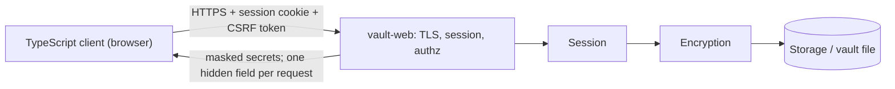

# Web GUI — Architecture & Security

Core document: `secure-password-manager.md`
This project builds on top of ICS0022 Secure Programming course project. 

## 1. Scope

This documents covers everything the HTTP surface introduces: TLS, vault creation and unlock, server-side sessions, CSRF, CSP and per-request authorization.

Everything regarding encryption, storage and other modules in found in `secure-password-manager.md`. It is covered server-side in Rust, as part of ICS0022 Secure Programming course project. 

## 2. Architecture

This app consists off:
- The web front end: a Rust HTTP server `vault-web`
- Rust core reused from ICS0022 Secure Programming project
- TypeScript browser client



In addition to main architecture, the `vault-web` module is added, which is responsible for TLS and session management. 
**Typescript** is used for UI only (and network protocols), main vault logic including memory handling and encryption is in **Rust**.

### Data flow

1) `POST /api/unlock` takes a vaultname and master password, opens that vault file and tries to unwrap the vault key. No password hash is stored; a failed unwrap is a failed unlock (`secure-password-manager.md` §3).

2) server opens a session, issues a new session cookie and a CSRF token.

3) `GET /api/secrets` returns the non-hidden fields of that vault's secrets only.

4) `POST /api/secrets/{title}/reveal` returns one hidden field of one secret for that request alone; secrets are identified by their title. Every handler resolves the vault from the session and only ever opens that vault file; no identity is ever read from the request body.

The idle timer is server-side and authoritative: on expiry (idle timeout, default 5 minutes, 1-60 per unlock, or 8 hours after unlock whatever the activity) the key is zeroed, the vault is locked and the next request gets a 401. The overview/detail split keeps at most one hidden field in the browser heap. Session holds a key across requests until session end.

All memory management is done server-side, described in `secure-password-manager.md` §2 & §3.

## 3. Design decisions

Server holds an unwrapped key for the life of a session; decryption stays on the server and the browser never receives the vault key or the whole vault (ADR-0012).

- Session credential: server-side session, `__Host-` prefixed `HttpOnly` `Secure` `SameSite=Strict` cookie, a new one on every unlock, deleted upon session closure. No bearer tokens.

- CSRF - per-session token in a request header on every state-changing request, `SameSite` and origin check

- Host check: only `localhost` and `127.0.0.1` on the server's port are accepted (DNS rebinding)

- Unlock and vault creation each cost a 256 MiB Argon2id run, so at most two run at once; further requests are refused

There is no SQL anywhere: vaults are flat files (ADR-0011), so there is no query to inject into.

## 4. Threat model

Master-password, vault-at-rest and vault-in-memory analysis in `secure-password-manager.md` §4.

- The browser is treated as semi-trusted - the user's own, but running extensions and other tabs. Thus, checking session state is necessary.
- User's input is validated before forwarding to inner modules.

### Out of scope

- User's browser session is trusted while the vault is unlocked.
- Unlock lockout per vaultname or IP: it would let anyone lock another user out of their vault. Guessing is slowed by the KDF cost and the constant failure delay, and failed unlocks are recorded in the audit log.
- Deployment beyond a local demo (reverse proxy, public hosting).

### Threat analysis

| Surface | Threat | Mitigation |
| --- | --- | --- |
| Transport, session | Secrets read in transit; cookie stolen, replayed, fixed, or surviving a restart | TLS with HSTS (short `max-age`, so other localhost servers aren't affected); server-side session, `Secure` cookie created on unlock and deleted on lock or timeout |
| Session | State-changing request forged by another origin | Per-session CSRF token, origin check |
| Session | Session left unattended | Auto-lock after the idle timeout (default 5 min) and 8 h after unlock; `Cache-Control: no-store` on every response, `Clear-Site-Data` on lock |
| Access control | Request naming another user's secret | Vault resolved from the session only; the server opens only that vault file, so other users' secrets are unreachable; unknown secret returns 404 |
| Injection | Vaultname used as a vault file name (path traversal) | Vaultnames allowlisted (restricted charset and length); vault path built only inside the vault directory |
| Injection | Malicious input reaching a query or rendered as markup | No query language (flat vault files, ADR-0011); validation, no inline scripts |
| Transport | DNS rebinding: a malicious site's domain resolving to the local server | Host header check, server bound to localhost |
| Availability | Flood of unlock requests exhausting memory (256 MiB per KDF run) | At most two KDF runs at once, a short queue, then 503 |
| Interface | Copied password left on the clipboard | Cleared after 20 seconds, best-effort: the browser only allows it while the page has focus |

### OWASP Top 10 2025

| OWASP 2025 | Covered by the threat model |
| --- | --- |
| A01 Broken Access Control |	Session cookie and CSRF token on every request; Origin checks block cross-origin calls; lock ends the session; the vault is resolved from the session only |
| A02 Security Misconfiguration	| Strict CSP |
| A03 Software Supply Chain Failures | Client bundle is served from inside the binary and nothing is fetched at runtime |
| A04 Cryptographic Failures | Crypto runs only in Rust, using Argon2id, XChaCha20-Poly1305 and HKDF-SHA-256, proven libraries are used |
| A05 Injection | Secret fields are escaped as text, never set with innerHTML; URL schemes allowlisted; CSP as backup |
| A06 Insecure Design |	:) |
| A07 Authentication Failures |	Generic unlock error with constant delay, whether or not the vaultname exists; new session cookie on every unlock; CSRF token in browser memory only; server-side idle timeout and absolute lifetime. |
| A08 Software or Data Integrity Failures |	Authenticated header blocks tampering, each save atomically replaces the vault file under a lock and fails on a revision conflict. Rollback to an older vault copy is not detected (accepted, see `secure-password-manager.md` threat model). |
| A09 Security Logging and Alerting Failures | Audit log module in `secure-password-manager.md` |
| A10 Mishandling of Exceptional Conditions	| Generic error messages with no internals; a panicking request locks that session and returns a generic 500; a save conflict locks the session (401) |


## 5. Planned pages

```
- Create vault  vaultname + master password, strength floor; creates the vault file
- Unlock        generic failure, constant delay; optional TOTP step (planned)
- Vault list    non-hidden fields only: title, username, URL, tags; search over them
- Secret detail hidden fields masked; per-field Reveal and Copy buttons
- Secret edit   add / edit / delete; an empty password is generated on the server; title read-only when editing
- Settings      (planned) clipboard timeout, TOTP enrolment, KDF upgrade, backup export, master password change, account management
```

## 6. Build and run
`vault-web` serves the compiled bundle from the same binary and terminates TLS itself. Without `--tls-cert`/`--tls-key` it generates and caches a self-signed `localhost` certificate; pass a `mkcert` certificate to avoid the browser warning.
```bash
cd web && npm install && npm run build         # emits the bundle into vault-web/assets
cargo run -p vault-web                         # serves HTTPS on 127.0.0.1:8443, prints the URL once
cargo run -p vault-web -- --tls-cert localhost.pem --tls-key localhost-key.pem
```
