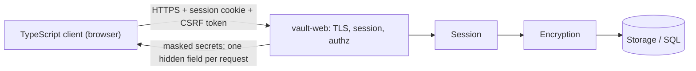

# Web GUI — Architecture & Security

Core document: `secure-password-manager.md`
This project builds on top of ICS0022 Secure Programming course project. 

## 1. Scope

This documents covers everything the HTTP surface introduces: TLS, vault creation and unlock, server-side sessions, CSRF, CSP and per-request authorization.

Everything regarding encryption, storage and other modules in found in `secure-password-manager.md`. It is covered server-side in Rust, as part of ICS0022 Secure Programming course project. 

## 2. Architecture

This app consists off:
- The web front end: a Rust HTTP server `vault-web`
- Rust core reused from ICS0022 Secure Programming project
- TypeScript browser client



In addition to main architecture, the `vault-web` module is added, which is responsible for TLS and session management. 
**Typescript** is used for UI only (and network protocols), main vault logic including memory handling and encryption is in **Rust**.

### Data flow

1) `POST /unlock` takes a vaultname and master password, opens that vault file and tries to unwrap the vault key. No password hash is stored; a failed unwrap is a failed unlock (`secure-password-manager.md` §3).

2) server opens a session, rotates the cookie and issues a CSRF token.

3) `GET /secrets` returns the non-hidden fields of that vault's secrets only.

4) `POST /secrets/{id}/reveal` returns one hidden field for that request alone. Every handler resolves the vault from the session and only ever opens that vault file; no identity is ever read from the request body.

The idle timer is server-side and authoritative: on expiry the key is zeroed, the vault is locked and the next request gets a 401. The overview/detail split keeps at most one hidden field in the browser heap. Session holds a key across requests until session end.

All memory management is done server-side, described in `secure-password-manager.md` §2 & §3.

## 3. Design decisions

Server holds an unwrapped key for the life of a session. Made for convenience, otherwise app is not usable.

- Session credential: server-side session, `HttpOnly` `Secure` `SameSite=Strict` cookie, rotated on unlock, deleted upon session closure

- CSRF - per-session token on every state-changing request, `SameSite` and origin check

SQL is not in the web layer, all statements parameterized in the core.

## 4. Threat model

Master-password, vault-at-rest and vault-in-memory analysis in `secure-password-manager.md` §4.

- The browser is treated as semi-trusted - the user's own, but running extensions and other tabs. Thus, checking session state is necessary.
- User's input is validated before forwarding to inner modules.

### Out of scope

- User's browser session is trusted while the vault is unlocked.

### Threat analysis

| Surface | Threat | Mitigation |
| --- | --- | --- |
| Transport, session | Secrets read in transit; cookie stolen, replayed, fixed, or surviving a restart | TLS with HSTS; server-side session, `Secure` cookie created on unlock and deleted on lock or timeout |
| Session | State-changing request forged by another origin | Per-session CSRF token, origin check |
| Session | Session left unattended | Auto-lock in 5 min, clear browser cache |
| Access control | Request naming another user's secret | Vault resolved from the session only; the server opens only that vault file, so other users' secrets are unreachable; unknown secret returns 404 |
| Injection | Vaultname used as a vault file name (path traversal) | Vaultnames allowlisted (restricted charset and length); vault path built only inside the vault directory |
| Injection | Malicious input reaching a query or rendered as markup | Parameterized statements; validation, no inline scripts |

### OWASP Top 10 2025

| OWASP 2025 | Covered by the threat model |
| --- | --- |
| A01 Broken Access Control |	Bearer token on every request; Origin checks and CORS block cross-origin calls; lock kills all tokens |
| A02 Security Misconfiguration	| Strict CSP |
| A03 Software Supply Chain Failures | Client bundle is served from inside the binary and nothing is fetched at runtime |
| A04 Cryptographic Failures | Crypto runs only in Rust, using Argon2id and AES / ChaCha20, proven libraries are used |
| A05 Injection | Secret fields are escaped as text, never set with innerHTML; URL schemes allowlisted; CSP as backup |
| A06 Insecure Design |	:) |
| A07 Authentication Failures |	Generic unlock error with constant delay, whether or not the vaultname exists; tokens in memory only, rotated; server-side idle timeout. |
| A08 Software or Data Integrity Failures |	Authenticated header blocks tampering, atomic rename on save. Rollback to an older vault copy is not detected (accepted, see `secure-password-manager.md` threat model). |
| A09 Security Logging and Alerting Failures | Audit log module in `secure-password-manager.md` |
| A10 Mishandling of Exceptional Conditions	| Panic on any error; locks the vault with a generic 401 error |


## 5. Planned pages

```
- Create vault  vaultname + master password, strength floor; creates the vault file
- Unlock        generic failure, constant delay, optional TOTP step
- Vault list    non-hidden fields only: title, username, URL, tags; search over them
- Secret detail hidden fields masked; per-field Reveal and Copy buttons
- Secret edit   add / edit / delete, password generator inline
- Settings      auto-lock and clipboard timeouts, TOTP enrolment, KDF upgrade, backup export, account management
```

## 6. Build and run
`vault-web` serves the compiled bundle from the same binary. TLS terminates in the server for development, behind a reverse proxy in deployment.
```bash
cd web && npm install && npm run build         # emits the bundle into vault-web/assets
cargo run -p vault-web -- --tls-cert dev.pem   # serves HTTPS, prints the URL once
```
